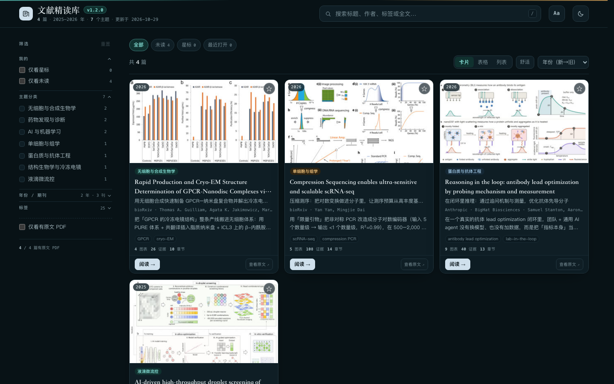

# DSH-Paper-DeepRead

**English** | [Chinese](README.zh.md)

A DeepSeek Harness (dsh) web plugin that bundles the Paper Deepread library site and the
`paper-deepread-html` deep-read skill. One install adds a sidebar entry that shows the
library - interactive reading reports with the original PDFs beside them - plus host-side
model tools for searching and reading papers and a management console for uploading PDFs
and maintaining reports.

## Features

- **Bundled library and sidebar entry** - the Paper Deepread library page served by the
  plugin at `/paper-deepread/index.html` and shown from the Paper Deepread sidebar entry;
  it ships with 4 sample reports, and `libraryDir` can serve an existing library instead.
- **`paper_deepread` model tool** - lists papers, searches titles / journals / tags /
  summaries / full text, and returns a report to read locally or by Web URL.
- **Upload -> deep-read -> report** - `paper_deepread_uploads` ingests PDFs into the managed
  inbox; `paper_deepread_reports` builds, hides and deletes reports. The plugin never calls
  a model itself.
- **Management console** - Upload / Report management / mobile access tabs, opened from the
  library page header in a new browser tab.
- **Mobile access** - a QR code for the LAN address and one for an automatically started
  Cloudflare quick tunnel.
- **Optional standalone-site integration** - with `siteUrl` set to a running Paper Deepread
  site, that site becomes the preferred mobile-access target.
- **Bundled skill** - `paper-deepread-html` is installed when missing and kept in sync.
- **No runtime dependencies** - the host imports only Node built-ins plus the
  `@deepseek-ai/dsh-tools` peer; the browser half is a single dependency-free file.

## Requirements

- DeepSeek Harness `^0.2.0-rc.2 || ^0.2.1-rc.2 || ^0.2.1-rc.3` (the `engines.dsh` range).
- Node.js `>= 24`.
- The `web` profile (the plugin needs the `webServer` and `tools` services).
- Optional: `cloudflared` for the external (temporary) quick tunnel.

## Install

Install into the Web profile from the release tarball or straight from GitHub:

```bash
dsh plugin --profile web add ./dsh-paper-deepread-1.7.0.tgz
dsh plugin --profile web add "github:HaoKuo/DSH-Paper-DeepRead#v1.7.0"
```

Restart the Web UI and open <http://127.0.0.1:3080>:

```bash
dsh web
```

Click **Paper Deepread** in the left sidebar. The library is also served directly at
<http://127.0.0.1:3080/paper-deepread/index.html>, the management console at
<http://127.0.0.1:3080/paper-deepread/manage.html>.

- Upgrade: run the same `dsh plugin --profile web add` command with the new tarball or
  GitHub tag, then restart `dsh web`.
- Uninstall: `dsh plugin --profile web remove dsh-paper-deepread`, then restart `dsh web`.
  The copied skill and the managed data directory are left in place.

## Usage

1. **Browse the library.** Open the sidebar entry, or the library URL directly; each paper
   card opens an interactive report with figure crops, redrawn SVG schematics and the
   untouched source PDF.
2. **Upload PDFs.** Open **Manage** (or **Upload**) in the library page header to reach the
   management console, then drag PDFs onto the Upload tab - up to 80 MB per file, checked
   for the `%PDF-` signature. Or ask the agent in chat and let it run the pipeline with
   `paper_deepread_uploads` (`list` / `ingest`) and `paper_deepread_reports` (`build`).
3. **Manage reports.** In the console's **Report management** tab, open a report or its RAW
   PDF, hide/unhide it, delete a report directory, or click **Rebuild index**
   (deterministic, no model involved).
4. **Mobile access.** In the console's **mobile access** tab, the external Cloudflare quick
   tunnel starts automatically; stop it with **Stop external access**. Scan the LAN QR code
   from a phone on the same Wi-Fi, or the external QR code from anywhere - the external URL
   is public and temporary.




## Configuration

The plugin works with no configuration. Optional row config:

| Option | Default | Meaning |
| --- | --- | --- |
| `dataDir` | `$DSH_HOME/paper-deepread` | Managed library, uploads, work directory and state files. |
| `libraryDir` | unset (seeded `dataDir/library`) | Serve an existing library root instead; skips seeding. |
| `siteUrl` | unset (feature off) | Base URL of a running standalone Paper Deepread site, for example `http://127.0.0.1:8080`; also the preferred mobile-access target. |
| `maxUploadBytes` | `83886080` (80 MB) | Per-file upload size limit. |
| `cloudflaredPath` | unset (auto-detect) | Explicit `cloudflared` binary for the quick tunnel. |
| `cloudflaredProxy` | unset (inherit environment) | Proxy handed to `cloudflared` as `HTTPS_PROXY` / `HTTP_PROXY`. |
| `lanPort` | `0` (ephemeral) | Preferred port for the read-only LAN fallback server. |

## Notes

- The library page has a Chinese / English language toggle; the management console UI is
  Chinese-only, so this README names its controls by function.
- The quick-tunnel URL is public and unauthenticated - anyone with the link can read every
  report and PDF - and it changes whenever the tunnel or `dsh web` restarts. Enable it only
  when needed and stop it when done.
- On macOS, `cloudflared` (a Go program) ignores the system proxy; behind a proxy such as
  ClashX set `cloudflaredProxy`, for example `socks5://127.0.0.1:7890`.
- The full details live in [docs/install.md](docs/install.md) and
  [docs/architecture.md](docs/architecture.md).

## Documentation and development

- [docs/install.md](docs/install.md) - install, verification and upload/report walkthroughs.
- [docs/architecture.md](docs/architecture.md) - host/client design and internals.
- [CHANGELOG.md](CHANGELOG.md) and [RELEASE_NOTES.md](RELEASE_NOTES.md) - release history.
- Repository: <https://github.com/HaoKuo/DSH-Paper-DeepRead>

```bash
npm run check   # node --check on every shipped JavaScript file
npm test        # node:test suites
npm run pack    # dist/dsh-paper-deepread-1.7.0.tgz + dist/SHA256SUMS
```

## License

[MIT](LICENSE) © 2026 HaoKuo
