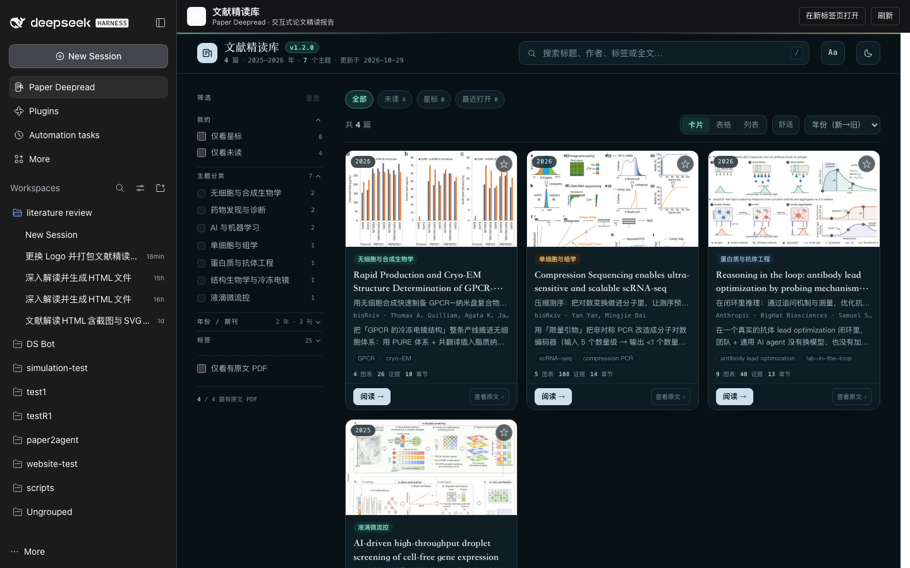

# DSH-Paper-DeepRead

**English** | [中文](README.zh.md)

A DeepSeek Harness (dsh) Web plugin that ships a complete deep-read paper library and the
skill that produces it. One install gives you a sidebar panel with interactive paper
reading reports, the original PDFs beside them, and a model tool that can find the right
paper in the same catalogue.



## What it is

DSH-Paper-DeepRead bundles two things into one installable dsh bundle:

1. **文献精读库 / Paper Deepread library** — a static site with four deep-read papers
   (2025–2026, Nature Communications / bioRxiv / Anthropic · BigHat Biosciences). Every
   paper has an interactive single-file HTML report with original figure crops, redrawn
   SVG schematics, a claims ledger, a critical appraisal, and the untouched source PDF.
   The library is served by this plugin at `/paper-deepread/index.html`.
2. **`paper-deepread-html` skill** — the full deep-read pipeline (SKILL.md, build/ingest
   scripts, report and library templates, references). On first activation the plugin
   copies it into `~/.dsh/skills/paper-deepread-html` **only when that directory does not
   exist**; an existing user copy is never overwritten.


The plugin also exposes one model tool, **`paper_deepread`**, so an agent can list the
bundled papers, substring-search titles / Chinese titles / journals / tags / summaries /
full text, and read a report locally or open its Web URL.

## Features

- Sidebar entry **Paper Deepread** that opens a full-height library page in the main
  panel, with an *open in new tab* link and a reload button.
- Host route `GET|HEAD /paper-deepread/*` serving the bundled `library/` directory with
  correct content types, `Content-Length`, percent-decoded paths (spaces, `·`, Chinese
  characters), and traversal protection.
- Model tool `paper_deepread` returning paper ids, bilingual titles, journals, tags,
  TL;DRs, absolute report/PDF paths, and encoded Web URLs.
- Skill self-registration that never overwrites an existing skill and never fails plugin
  activation.
- No runtime dependencies: the host imports only Node built-ins plus the
  `@deepseek-ai/dsh-tools` peer; the browser half is a single dependency-free file.

## Requirements

- DeepSeek Harness `0.2.0-rc.2` − `0.2.1-rc.3`
- Node.js `>= 24`
- The `web` profile (the plugin needs `webServer` and `tools`)

## Install

Download `dsh-paper-deepread-1.1.3.tgz` from the GitHub release, then install it into the
Web profile:

```bash
dsh plugin --profile web add ./dsh-paper-deepread-1.1.3.tgz
```

Restart the Web UI:

```bash
dsh web
```

Then open <http://127.0.0.1:3080> and click the **Paper Deepread** icon in the left
sidebar. The bundled library is also reachable directly at
<http://127.0.0.1:3080/paper-deepread/index.html>.

See [docs/install.md](docs/install.md) for the exact commands, verification steps, and
uninstall instructions.

## Upload papers and manage reports (v1.1.0)

The panel now has three tabs: **文献库 | 上传 | 报告管理**.


- **Upload** — drag & drop (or pick) one or more PDFs. Files go into the managed
  inbox at `<dataDir>/uploads/<id>.pdf` (80 MB default limit, `%PDF-` magic checked),
  with per-file progress and a list of uploads/statuses you can delete.
- **Agent handoff** — the plugin never calls a model. The upload tab shows a prefilled
  instruction; copy it into a chat so an agent calls `paper_deepread_uploads`
  (`list` / `ingest` / `env` / `delete`) and `paper_deepread_reports`
  (`list` / `build` / `rebuild` / `delete` / `hide`) to run the bundled skill and
  assemble the report.
- **Standalone `manage.html`** — the bundled library page now has 「上传」「管理」 header
  entries that open the same self-contained management console (`library/manage.html`).
  It works at the site root (`/manage.html` → site API) and inside the plugin
  (`/paper-deepread/manage.html` → plugin API) because every API URL is relative.
- **Report management** — a table of reports with open/report-raw links, hide/unhide
  (current-window filtering via `library.json`), delete one report directory, and a
  one-click **重建索引** that deterministically rebuilds `index.html` / `index.md`
  with `build_library.py` (no model involved).


The managed library lives in a data directory (`$DSH_HOME/paper-deepread` by default):

```text
~/.dsh/paper-deepread/
├── library/      seeded once from the packaged 文献精读库, then user-owned
├── uploads/      uploaded PDFs waiting to be deep-read
├── work/<id>/    ingest output + agent-authored report sources
├── state.json    upload inbox and statuses
└── .seed.json    one-time seed marker
```

Report statuses flow `uploaded -> ingested -> reported` (`failed` carries the error).
If you set the legacy `libraryDir` option, that directory is used as the managed root
and seeding is skipped, so you can point the plugin at an existing local 文献精读库.

## The `paper_deepread` tool

| Argument | Type | Meaning |
| --- | --- | --- |
| `query` | string, optional | Case-insensitive substring over English/Chinese titles, journals, tags, TL;DR, and full text. Returns up to 20 ranked hits with snippets. |
| `id` | string, optional | Paper id, report directory name, or 1-based index. Returns one paper. |

With no arguments the tool lists every paper in the bundled library. Each paper carries:

- `reportHtmlPath` — absolute path of the interactive HTML report (read it with local file tools)
- `rawPdfPath` — absolute path of the untouched source PDF
- `previewPdfPath` — absolute path of the figure-cropped report PDF
- `webUrl` — encoded relative URL that resolves under `/paper-deepread/`

## Configuration

The plugin works with no configuration. Optional row config:

```yaml
- insert:
    - id: paper-deepread
      name: dsh-paper-deepread
      config:
        libraryDir: /absolute/path/to/library   # serve another static-site directory
        skillsDir: /absolute/path/to/skills     # copy the skill elsewhere
        registerSkill: false                    # disable skill self-registration
```

| Option | Default | Description |
| --- | --- | --- |
| `dataDir` | `$DSH_HOME/paper-deepread` | Managed library, uploads, work directory, and `state.json`. |
| `libraryDir` | unset (use seeded `dataDir/library`) | External 文献精读库 root; disables seeding (legacy-compatible). |
| `skillsDir` | `$DSH_HOME/skills` (`~/.dsh/skills`) | Where the bundled skill is installed. |
| `registerSkill` | `true` | Set `false` to never copy the bundled skill. |
| `maxUploadBytes` | `83886080` (80 MB) | Per-upload size limit. |

## Repository layout

```text
DSH-Paper-DeepRead/
├── src/index.js        # host half: Web route + API + tools + skill registration
├── src/manager.js      # managed library, API dispatch, model tools
├── src/store.js        # dataDir, one-time seed, atomic state.json
├── src/uploads.js      # PDF validation + inbox storage
├── src/reports.js      # report scan/hide/delete + library rebuild
├── src/python.js       # skill Python resolution + child processes
├── src/library.js      # library catalogue parser/search (stdlib only)
├── src/skill.js        # conservative skill self-registration (stdlib only)
├── lib/client.js       # browser half: sidebar icon + main-panel page
├── cordis.patch.yml    # one bundle row: paper-deepread → dsh-paper-deepread
├── skills/paper-deepread-html/   # the bundled deep-read skill
├── library/            # the bundled 文献精读库 static site
├── assets/icon.svg     # original plugin artwork
├── docs/               # install + architecture notes, screenshots
├── scripts/pack.sh     # syntax check, npm pack, SHA256SUMS
└── dist/               # build output (gitignored)
```

See [docs/architecture.md](docs/architecture.md) for the host/client design.

## Development

```bash
npm run check   # node --check every shipped JavaScript file
npm run pack    # dist/dsh-paper-deepread-1.0.0.tgz + dist/SHA256SUMS
```

The package is published as a GitHub release tarball; it is not required to be on npm.

## Known limitations

- The first ingest/report build prepares a PyMuPDF interpreter through the bundled
  skill's `setup_env.sh` (cached venv under `~/.cache/paper-deepread`; the first run may
  download PyMuPDF). Rebuilding the library index does not need PyMuPDF: without a
  prepared interpreter it falls back to a plain `python3 --no-thumbs` rebuild.
- The plugin never calls a model itself: upload -> deep-read stays agent-driven through
  `paper_deepread_uploads` / `paper_deepread_reports`.
- `library/index.html` probes `/api/library` for live updates; that endpoint does not
  exist in the plugin route, so the page shows its embedded catalogue as an offline
  snapshot. Navigation, reports, and PDFs are unaffected.
- The browser panel is loaded through dsh's client module system; the host and client
  halves activate only in a Web profile.

## Uninstall

```bash
dsh plugin --profile web remove dsh-paper-deepread
```

Restart `dsh web`. The copied skill under `~/.dsh/skills/paper-deepread-html` is left in
place; delete it manually if you do not want to keep it.

## License

[MIT](LICENSE) © 2026 HaoKuo

Repository: <https://github.com/HaoKuo/DSH-Paper-DeepRead>
