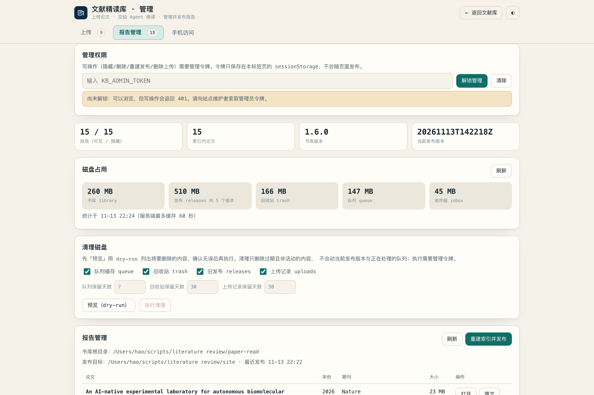

# DSH-Paper-DeepRead

**English** | [Chinese](README.zh.md)

A DeepSeek Harness (dsh) Web plugin that ships a complete deep-read paper library and the
skill that produces it. One install gives you a sidebar entry that opens the bundled
library — interactive paper reading reports with the original PDFs beside them — plus a
model tool that can find the right paper in the same catalogue.


## What it is

DSH-Paper-DeepRead bundles two things into one installable dsh bundle:

1. **Paper Deepread library** — a static site with four deep-read papers
   (2025–2026, Nature Communications / bioRxiv / Anthropic · BigHat Biosciences). Every
   paper has an interactive single-file HTML report with original figure crops, redrawn
   SVG schematics, a claims ledger, a critical appraisal, and the untouched source PDF.
   The library is served by this plugin at `/paper-deepread/index.html`.
2. **`paper-deepread-html` skill** — the full deep-read pipeline (SKILL.md, build/ingest
   scripts, report and library templates, references). The plugin installs it into
   `~/.dsh/skills/paper-deepread-html` when that directory is missing, and since v1.2.0
   keeps it in sync with the bundled version through a hash-tracked, backup-first update
   policy: user edits are always preserved, and `skillSync: "keep"` disables updates.


Since v1.7.0 the plugin panel is a **thin client**: selecting **Paper Deepread** in the
sidebar shows only the bundled library page. Uploading, report management and mobile access
live in the library's own **management console**, which the library page header opens in a
new browser tab.

The library page has its own **Chinese / English** language toggle; the management console
UI itself is Chinese-only, so this README names its controls by function.

The plugin also exposes the **`paper_deepread`** model tool, so an agent can list the
bundled papers, substring-search titles / Chinese titles / journals / tags / summaries /
full text, and read a report locally or open its Web URL. Two more tools
(`paper_deepread_uploads`, `paper_deepread_reports`) drive the upload -> ingest -> build
pipeline described below.

## Features

- **Thin client panel (v1.7.0)** — the **Paper Deepread** sidebar entry shows the bundled
  library page as a full-height, same-origin iframe and nothing else: no plugin tab row,
  no toolbar. The library page header keeps the **Upload** / **Manage** entries that open
  the management console in a new browser tab.
- Host route `GET|HEAD /paper-deepread/*` serving the bundled `library/` directory with
  correct content types, `Content-Length`, percent-decoded paths (spaces, `·`, Chinese
  characters), and traversal protection.
- Model tool `paper_deepread` returning paper ids, bilingual titles, journals, tags,
  TL;DRs, absolute report/PDF paths, and encoded Web URLs.
- Skill self-registration that never fails plugin activation.
- **Skill version sync (v1.2.0)** — reads `version:` from the SKILL.md frontmatter, records
  a content hash in `<dataDir>/skill-state.json`, updates only *unmodified* copies the
  plugin installed itself (old version backed up to `<skillsDir>/.backup/`), never
  downgrades, and reports `skillVersion` / `installedSkillVersion` in `/api/state` and the
  `paper_deepread` tool.
- **Optional standalone-site integration (v1.2.0)** — with `siteUrl` configured the host
  still proxies a running Paper Deepread site (`GET /paper-deepread/api/site/health`,
  `POST /paper-deepread/api/site/upload`) and prefers it as the mobile-access target. The
  plugin panel no longer renders its own upload card: PDFs are handed to the site's
  worker from the site's own management console at `<siteUrl>/manage.html`.
- **Mobile access (v1.7.0)** — the management console has a third **mobile access** tab
  next to **Upload** / **Report management**: an automatically started Cloudflare quick
  tunnel (external) and the first LAN address, each with a copyable URL and a locally
  rendered, scannable QR code. Nothing is probed or bound on page load; the host API and
  config keys are unchanged from v1.6.0.
- No runtime dependencies: the host imports only Node built-ins plus the
  `@deepseek-ai/dsh-tools` peer; the browser half is a single dependency-free file.

## Requirements

- DeepSeek Harness `0.2.0-rc.2` − `0.2.1-rc.3`
- Node.js `>= 24`
- The `web` profile (the plugin needs `webServer` and `tools`)
- Optional: `cloudflared` (Cloudflare) for the external (temporary) quick tunnel

## Version matrix

| Component | Version |
| --- | --- |
| Deep-read site backend (`deploy/serve.py`) | 1.6.0 |
| Paper Deepread library index | 1.6.0 |
| **DSH-Paper-DeepRead plugin (this package)** | **1.7.0** |
| Bundled `paper-deepread-html` skill | 1.5.1 |

The plugin works standalone. The optional standalone-site integration additionally needs
a running site ≥ 1.4.0 (the `/api/health` endpoint plus the upload-token and queue
controls).

## Install

Download `dsh-paper-deepread-1.7.0.tgz` from the GitHub release, then install it into the
Web profile:

```bash
dsh plugin --profile web add ./dsh-paper-deepread-1.7.0.tgz
```

Restart the Web UI:

```bash
dsh web
```

Then open <http://127.0.0.1:3080> and click the **Paper Deepread** icon in the left
sidebar. The panel shows the bundled library page; its header's **Manage** entry opens the
management console (upload, report management, mobile access) in a new browser tab, also
reachable directly at <http://127.0.0.1:3080/paper-deepread/manage.html>. The library is
available at <http://127.0.0.1:3080/paper-deepread/index.html>.

See [docs/install.md](docs/install.md) for the exact commands, verification steps, and
uninstall instructions.

## Upload papers and manage reports

Uploading and report management happen in the **management console** — the
self-contained `library/manage.html` page that the Paper Deepread library ships with. The
library page header has two entries, **Upload** (the console on its upload tab) and
**Manage** (the console as opened), and both open it in a new browser tab. Every API URL in
the page is relative, so the same page adapts to where it is served:

- **Through the plugin** — the library page lives at `/paper-deepread/index.html`, so
  these links resolve to `/paper-deepread/manage.html` and the console talks to the
  plugin host's `/paper-deepread/api/*`: the plugin's managed inbox and report tools.
- **On the standalone site** — at the site root the page is `/manage.html` and talks to
  the site API (`deploy/serve.py`), whose background worker deep-reads uploads by itself.

The console has three tabs: **Upload | Report management | Mobile access** — the third one
is described under Mobile access below.

- **Upload** — drag & drop (or pick) one or more PDFs. Through the plugin they go into the
  managed inbox at `<dataDir>/uploads/<id>.pdf` (80 MB default limit, `%PDF-` magic
  checked), with per-file progress and a list of uploads/statuses you can delete.
- **Agent handoff** — the plugin never calls a model. When the console is opened through
  the plugin, the upload tab also shows a prefilled instruction; copy it into a chat (or
  just ask) so an agent calls `paper_deepread_uploads` (`list` / `ingest` / `env` /
  `delete`) and `paper_deepread_reports` (`list` / `build` / `rebuild` / `delete` /
  `hide`) to run the bundled skill and assemble the report.
- **Report management** — a table of reports with open/report-raw links, hide/unhide
  (current-window filtering via `library.json`), delete one report directory, and a
  one-click **Rebuild index** that deterministically rebuilds `index.html` / `index.md`
  with `build_library.py` (no model involved).



The managed library lives in a data directory (`$DSH_HOME/paper-deepread` by default):

```text
~/.dsh/paper-deepread/
├── library/          seeded once from the packaged library, then user-owned
├── uploads/          uploaded PDFs waiting to be deep-read
├── work/<id>/        ingest output + agent-authored report sources
├── state.json        upload inbox and statuses
├── skill-state.json  installed skill version + content hash (v1.2.0)
├── lan-server.json   remembered mobile-access LAN fallback port (v1.6.0)
├── tunnel.json       last mobile-access tunnel state snapshot (v1.6.0)
└── .seed.json        one-time seed marker
```

Report statuses flow `uploaded -> ingested -> reported` (`failed` carries the error).
If you set the legacy `libraryDir` option, that directory is used as the managed root
and seeding is skipped, so you can point the plugin at an existing local library.

## Standalone site integration (v1.2.0)

The plugin can also point at a running **Paper Deepread site** (`deploy/serve.py`), which
runs a background worker and publishes reports into its own library. Configure its base
URL:

```yaml
config:
  siteUrl: http://127.0.0.1:8080
```

`siteUrl` has two host-side effects, unchanged since v1.2.0:

- it becomes the preferred target for mobile access (the phone opens the standalone site,
  not `dsh web`), and
- it enables two same-origin proxy routes: `GET /paper-deepread/api/site/health` (proxies
  `<siteUrl>/api/health`, 5 s timeout, 5 s cache) and
  `POST /paper-deepread/api/site/upload` (forwards a raw PDF body with `X-Filename`,
  `Content-Type`, and the optional `X-KB-Upload-Token` to `<siteUrl>/api/upload`,
  120 s timeout, and returns the site JSON verbatim).

The plugin panel no longer renders a site status/upload card of its own (v1.7.0): to hand
PDFs to the site's worker, open the site's own management console at
`<siteUrl>/manage.html` — its Upload tab uploads straight to the site API. The plugin never
stores site credentials; the upload token is per-request browser state only, and the site
API stays same-origin-only.

## Skill version sync (v1.2.0)

The bundled skill declares a `version:` field in its SKILL.md frontmatter (currently
`1.5.1`). On every activation the plugin compares it with the installed copy under
`~/.dsh/skills/paper-deepread-html`:

| Installed copy | Behaviour |
| --- | --- |
| missing | install the bundled skill, record version + content hash |
| `skillSync: "keep"` | never update an existing copy (log only) |
| version == bundled | skip |
| version > bundled | skip (never downgrade) |
| version < bundled, tree byte-identical to the recorded hash | back up to `<skillsDir>/.backup/paper-deepread-html-<oldVersion>-<UTC>/`, copy the bundled tree, refresh the hash |
| version < bundled, tree modified or not tracked | keep the user's copy and warn — no silent overwrite |

`skill-state.json` in the managed data directory records the installed version, the
content hash, the plugin package version, and `installedAt`. Copies that existed before
v1.2.0 have no recorded hash and are therefore treated as user-managed (kept, warned);
delete the installed directory once if you want the plugin to manage it from then on.

## Mobile access

The mobile-access UI lives in the library's **management console** (v1.6.0 feature; a
console tab since v1.7.0). On the bundled library page click **Manage** in the top-right
header — the console opens in a new browser tab — then select the **mobile access** tab
next to **Upload** / **Report management**. The tab is part of `manage.html` and calls
`api/access` relatively, which resolves to the plugin's same-origin
`/paper-deepread/api/access` when the console is opened through the plugin. That is the
supported origin: when the same page is opened directly on the standalone site (e.g.
`http://<host>:8080/manage.html`), the tab shows a note that mobile access requires the
DSH panel.

The tab shows two blocks, side by side on wide screens:

- **External (temporary)** — the Cloudflare quick tunnel. It starts automatically when the
  tab is opened (default-on since v1.6.2) and shows a status chip: `connecting` /
  `enabled` / `failed` / `not started`. **Stop external access** stops it. Without
  `cloudflared` the block explains the limitation and the LAN block still works.
- **LAN · `<IP>`** — the first non-loopback IPv4 address of this machine (`en0` ranked
  first). Exactly one LAN address is shown; the loopback and Bonjour entries are not
  rendered. It works for a phone on the same Wi-Fi network.

Each block shows the URL (selectable, with **Copy link**) and a QR code rendered locally by
the plugin host from that same URL — no external QR service is involved. **Refresh link**
re-probes the LAN address and, while the tunnel is running or failed, rebuilds it with a
new URL.


### What the phone opens

`dsh web` binds loopback only (`127.0.0.1:3080`), so a phone cannot open the DSH Web page
itself. The mobile-access runtime therefore resolves its target in this order:

1. the standalone Paper Deepread library site when `siteUrl` is configured — the phone
   opens the site, not `dsh web`;
2. otherwise a **read-only LAN static server** that the plugin starts lazily on first use.
   It serves the managed library on `0.0.0.0` with GET/HEAD static files only (no API and
   no uploads, so a management page may load but its API calls are not answered), prefers
   `lanPort` when set, and remembers the bound port in `<dataDir>/lan-server.json` so the
   same LAN URL keeps working;
3. otherwise the DSH Web library page itself, with a hint — that address only works on
   this machine, so configure `siteUrl` or use the tunnel to read it from a phone.

The LAN fallback server and the tunnel child are released when the plugin is disposed
(the bundle is disabled or `dsh web` restarts).

### Optional Cloudflare quick tunnel

The **external (temporary)** tunnel starts automatically when the mobile access tab is
opened (default-on since v1.6.2; stop it with **Stop external access**): the plugin runs
`cloudflared tunnel --url <target> --no-autoupdate` and reads the random
`https://<words>.trycloudflare.com` URL it prints. Nothing is spawned on page load or on
plugin activation, and nothing runs while the tab has never been opened; after the first
attempt the tunnel is not retried automatically (reload the management page to start it
again).

`cloudflared` is auto-detected from, in order: the `cloudflaredPath` config, the
`CLOUDFLARED_BIN` environment variable, `/opt/homebrew/bin/cloudflared`,
`/usr/local/bin/cloudflared`, then every directory on `PATH`. Without it the block reports
that `cloudflared` was not found, so the external tunnel cannot be started, and the LAN
block still works.

The printed URL is accepted only after cloudflared's `quick Tunnel has been created`
banner and only for multi-word `https://<words>.trycloudflare.com` hostnames, so the
Cloudflare API endpoint that appears in an error message can never be shown as the tunnel
URL. When quick-tunnel creation fails, the block shows `failed` with the trimmed
cloudflared message — never a dead QR code — and **Refresh link** retries.

On macOS, `cloudflared` is a Go program and ignores the system proxy, so behind a proxy
such as ClashX quick-tunnel creation can fail with a `failed to request quick Tunnel` error
(`context deadline exceeded` / `connection reset`). Set `cloudflaredProxy` to the proxy your
system uses — `socks5://127.0.0.1:7890` works on this machine, while routing the HTTP
CONNECT request through a plain HTTP proxy is flakier — and the plugin passes it to the
child as both `HTTPS_PROXY` and `HTTP_PROXY`. With no `cloudflaredProxy` the child inherits
the plugin environment.

The quick-tunnel URL is temporary: it changes whenever the tunnel or `dsh web` restarts, so
refresh the QR code before sharing. **Stop external access** stops the tunnel; reload the
management page to start it again, and **Refresh link** rebuilds a running or failed tunnel
with a new address.

> **Security:** the tunnel publishes the library to the public internet with no
> authentication — anyone who has the link can read every report and PDF. Enable it only
> when you need it, share the link/QR code only with people you trust, and close it when
> you are done. The LAN fallback server is read-only, but it is reachable by any device on
> the same network while `dsh web` runs.

Both routes live under the existing prefix route and need no extra setup:
`GET /paper-deepread/api/access` (add `?refresh=1` to bypass the 8 s reachability cache) and
`POST /paper-deepread/api/access/tunnel` with `{"action":"start"|"stop"|"refresh"}`.

## The `paper_deepread` tool

| Argument | Type | Meaning |
| --- | --- | --- |
| `query` | string, optional | Case-insensitive substring over English/Chinese titles, journals, tags, TL;DR, and full text. Returns up to 20 ranked hits with snippets. |
| `id` | string, optional | Paper id, report directory name, or 1-based index. Returns one paper. |

With no arguments the tool lists every paper in the bundled library. Each paper carries:

- `reportHtmlPath` — absolute path of the interactive HTML report (read it with local file tools)
- `rawPdfPath` — absolute path of the untouched source PDF
- `previewPdfPath` — absolute path of the figure-cropped report PDF
- `webUrl` — encoded relative URL that resolves under `/paper-deepread/`

## Configuration

The plugin works with no configuration. Optional row config:

```yaml
- insert:
    - id: paper-deepread
      name: dsh-paper-deepread
      config:
        libraryDir: /absolute/path/to/library   # serve another static-site directory
        skillsDir: /absolute/path/to/skills     # copy the skill elsewhere
        registerSkill: false                    # disable skill install/sync
        skillSync: update                       # update | keep (bundled skill sync)
        siteUrl: http://127.0.0.1:8080          # optional standalone site (preferred mobile-access target)
        cloudflaredPath: /opt/homebrew/bin/cloudflared  # optional quick-tunnel binary
        cloudflaredProxy: "socks5://127.0.0.1:7890"     # optional proxy for cloudflared
        lanPort: 0                              # optional preferred LAN fallback port
```

| Option | Default | Description |
| --- | --- | --- |
| `dataDir` | `$DSH_HOME/paper-deepread` | Managed library, uploads, work directory, `state.json`, and `skill-state.json`. |
| `libraryDir` | unset (use seeded `dataDir/library`) | External library root; disables seeding (legacy-compatible). |
| `skillsDir` | `$DSH_HOME/skills` (`~/.dsh/skills`) | Where the bundled skill is installed/updated. |
| `registerSkill` | `true` | Set `false` to never install or update the bundled skill. |
| `skillSync` | `update` | `update` syncs the skill when tracked and unmodified; `keep` never updates an existing copy. |
| `siteUrl` | unset (feature off) | Base URL of a running deep-read site, e.g. `http://127.0.0.1:8080`. Enables the two site proxy routes and is the preferred target for mobile access. |
| `cloudflaredPath` | unset (auto-detect) | Explicit `cloudflared` binary for the external (temporary) quick tunnel. Detection also checks `CLOUDFLARED_BIN`, the Homebrew locations, and `PATH`. |
| `cloudflaredProxy` | unset (inherit the plugin environment) | Optional proxy handed to the `cloudflared` child as `HTTPS_PROXY`/`HTTP_PROXY`, e.g. `socks5://127.0.0.1:7890`. Needed on macOS because cloudflared (Go) ignores the system proxy. |
| `lanPort` | `0` (ephemeral) | Preferred port for the read-only LAN fallback server used by mobile access; the chosen port is remembered in `<dataDir>/lan-server.json`. |
| `maxUploadBytes` | `83886080` (80 MB) | Per-upload size limit for the plugin's own inbox. |

## Repository layout

```text
DSH-Paper-DeepRead/
├── src/index.js        # host half: Web route + API + tools + skill registration
├── src/manager.js      # managed library, API dispatch, model tools
├── src/store.js        # dataDir, one-time seed, atomic state.json
├── src/uploads.js      # PDF validation + inbox storage
├── src/reports.js      # report scan/hide/delete + library rebuild
├── src/python.js       # skill Python resolution + child processes
├── src/library.js      # library catalogue parser/search (stdlib only)
├── src/skill.js        # skill install + version sync + content hashes (stdlib only)
├── src/site.js         # optional standalone-site health/upload proxy (stdlib only)
├── src/qr.js           # pure QR Code encoder + compact SVG renderer (stdlib only)
├── src/access.js       # mobile-access target resolution, LAN/Bonjour candidates, QR payloads
├── src/lan.js          # lazy read-only LAN fallback server for the managed library
├── src/tunnel.js       # optional Cloudflare quick-tunnel child manager
├── lib/client.js       # browser half: thin iframe wrapper (sidebar icon + library page)
├── cordis.patch.yml    # one bundle row: paper-deepread → dsh-paper-deepread
├── skills/paper-deepread-html/   # the bundled deep-read skill
├── library/            # the bundled library static site (index + reports + manage.html)
├── tests/              # node:test suites (units, API, skill sync, site proxy, mobile access)
├── assets/icon.svg     # original plugin artwork
├── docs/               # install + architecture notes, screenshots
├── scripts/pack.sh     # syntax check, npm pack, SHA256SUMS
└── dist/               # build output (gitignored)
```

See [docs/architecture.md](docs/architecture.md) for the host/client design.

## Development

```bash
npm run check   # node --check every shipped JavaScript file
npm test        # node:test suites (units, API, skill sync, site proxy, mobile access)
npm run pack    # dist/dsh-paper-deepread-1.7.0.tgz + dist/SHA256SUMS
```

The package is published as a GitHub release tarball; it is not required to be on npm.

## Known limitations

- The first ingest/report build prepares a PyMuPDF interpreter through the bundled
  skill's `setup_env.sh` (cached venv under `~/.cache/paper-deepread`; the first run may
  download PyMuPDF). Rebuilding the library index does not need PyMuPDF: without a
  prepared interpreter it falls back to a plain `python3 --no-thumbs` rebuild.
- The plugin never calls a model itself: upload -> deep-read stays agent-driven through
  `paper_deepread_uploads` / `paper_deepread_reports`. PDFs handed to a standalone site's
  worker from the site management console are processed by the site's own pipeline; the
  plugin still runs no model.
- Skill sync only updates copies it installed itself (tracked by a content hash). A skill
  directory that already existed before v1.2.0 is treated as user-managed and kept with a
  warning; delete it once to let the plugin manage it.
- The standalone-site integration needs the site to be running and reachable from the
  Harness host; the site API stays same-origin-only, and the plugin's two proxy routes are
  the only way to reach it from the Harness origin.
- The mobile access tab only works when the management console is opened through the plugin
  (`/paper-deepread/manage.html`); on the standalone site it shows a note that the feature
  requires the DSH panel.
- Mobile access never exposes `dsh web` itself: the DSH Web listener stays loopback-bound,
  and the phone opens the standalone site, the plugin's read-only LAN fallback server, or
  the temporary tunnel in front of one of those.
- The tunnel is public and unauthenticated, and its URL changes on restart; enable it only
  when needed and close it when done. The LAN fallback server is read-only but stays
  reachable on `0.0.0.0` (ephemeral port or `lanPort`) for as long as the plugin runs.
- `library/index.html` probes `/api/library` for live updates; that endpoint does not
  exist in the plugin route, so the page shows its embedded catalogue as an offline
  snapshot. Navigation, reports, and PDFs are unaffected.
- The browser panel is loaded through dsh's client module system; the host and client
  halves activate only in a Web profile. Since v1.7.0 the panel is a single full-height
  iframe of the bundled library and renders no plugin chrome of its own.

## Uninstall

```bash
dsh plugin --profile web remove dsh-paper-deepread
```

Restart `dsh web`. The copied skill under `~/.dsh/skills/paper-deepread-html` is left in
place (delete it manually if you do not want to keep it); old copies backed up by the
version sync stay under `~/.dsh/skills/.backup/`. The managed data directory
(`~/.dsh/paper-deepread`, including `skill-state.json`) is not removed automatically.

## License

[MIT](LICENSE) © 2026 HaoKuo

Repository: <https://github.com/HaoKuo/DSH-Paper-DeepRead>
