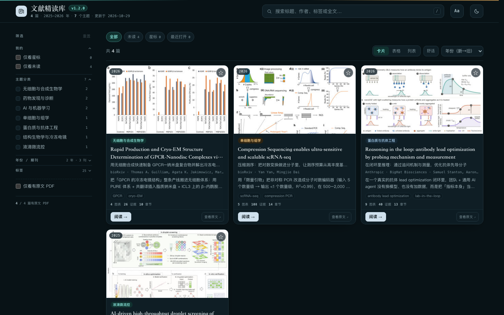
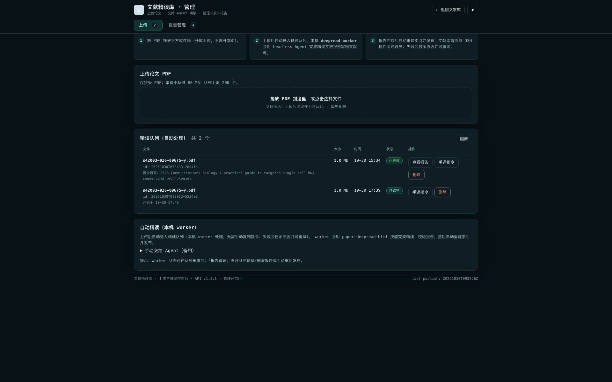
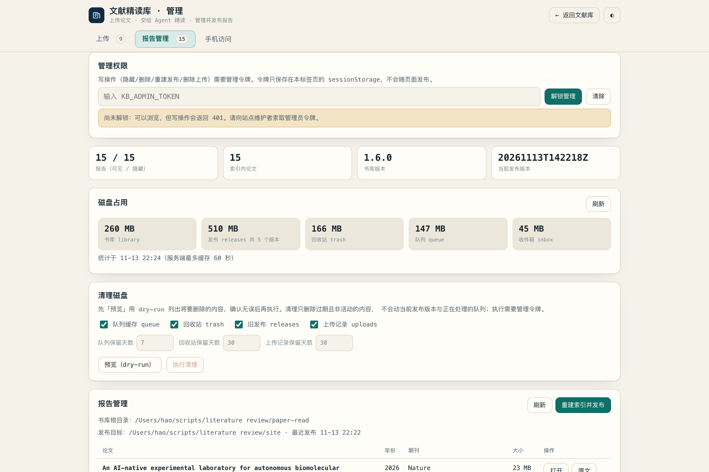
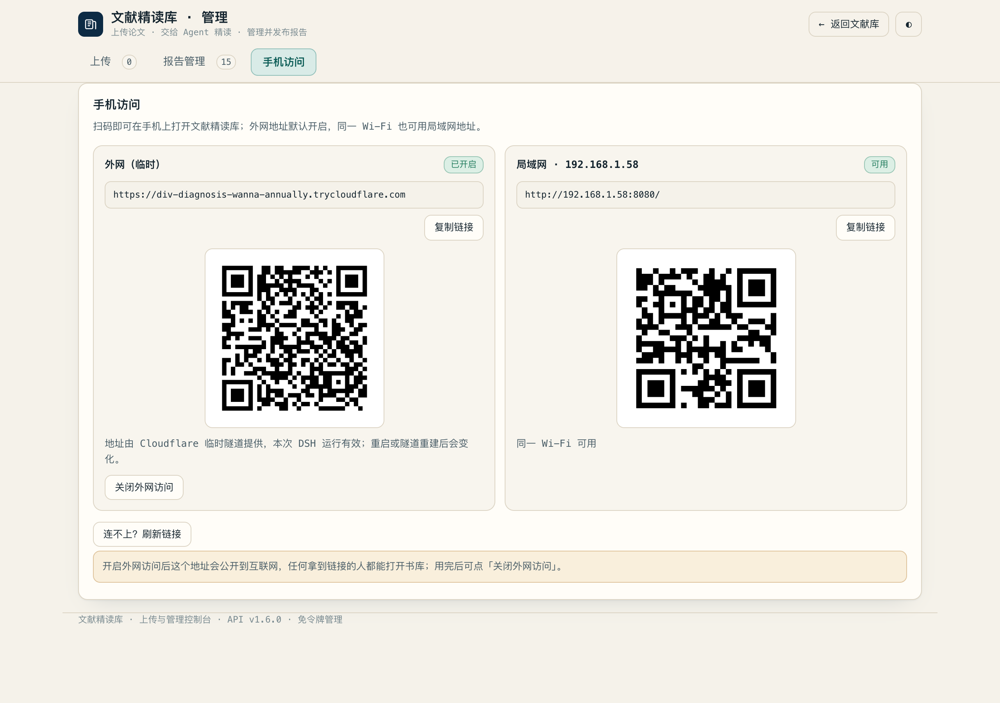

# DSH-Paper-DeepRead

[English](README.md) | **中文**

DeepSeek Harness（dsh）Web 插件：把完整的「文献精读库」和产出它的精读技能一起打包。装上之后，
左侧边栏多一个面板，可直接浏览交互式论文精读报告与原文 PDF；同时给模型一个工具，
让它能在同一份书目里找到目标论文。


## 它包含什么

DSH-Paper-DeepRead 把一个 dsh 插件包做成两件事：

1. **文献精读库** —— 收录 4 篇精读论文（2025–2026，Nature Communications / bioRxiv /
   Anthropic · BigHat Biosciences）。每篇都有一份单文件交互式 HTML 精读报告（原文图表裁切、
   SVG 重绘示意图、证据账本、批判性评估）以及未改动的原文 PDF。插件在
   `/paper-deepread/index.html` 提供这个站点。
2. **`paper-deepread-html` 技能** —— 完整的论文精读流水线（SKILL.md、摄取/构建脚本、
   报告与书库模板、参考文档）。目录不存在时插件会把它安装到
   `~/.dsh/skills/paper-deepread-html`；v1.2.0 起还会按「内容 hash 追踪 + 先备份」的
   策略与内置版本同步：用户改过的副本永远保留，`skillSync: "keep"` 可关闭自动更新。

   

插件还注册一个模型工具 **`paper_deepread`**：列出书目、按标题/中文标题/期刊/标签/摘要/全文
做大小写不敏感的包含搜索，并返回本地报告路径或 Web 链接。

## 功能

- 侧边栏入口 **Paper Deepread**，点击后主面板全高显示精读库页面；标签栏右侧同一行收着「刷新」「在新标签页打开」两个书库动作和「手机访问」入口（v1.6.1 起合并为单行，不再有独立工具栏行）。
- 宿主路由 `GET|HEAD /paper-deepread/*`：正确的 Content-Type、Content-Length、百分号解码
  （路径含空格、`·`、中文）、路径穿越防护。
- 模型工具 `paper_deepread`：返回论文 id、双语标题、期刊、标签、TL;DR、报告/PDF 绝对路径、
  编码后的 Web URL。
- 技能自注册与版本同步：安装失败只告警、不影响插件激活。
- **技能版本同步（v1.2.0）** —— 从 SKILL.md frontmatter 读取 `version:`，在
  `<dataDir>/skill-state.json` 记录内容 hash；只更新「由插件安装且未被修改」的旧副本
  （旧版备份到 `<skillsDir>/.backup/`），绝不降级；`/api/state` 与 `paper_deepread`
  工具输出都会带 `skillVersion` / `installedSkillVersion`。
- **可选的自动精读流水线（v1.2.0）** —— 配置 `siteUrl` 后，上传标签页顶部出现
  **自动精读**卡片：站点 `/api/health` 提供 worker/队列状态；PDF 经
  `POST /paper-deepread/api/site/upload` 原样代理上传（转发文件名/Content-Type/可选
  上传令牌，120 秒超时）；重复/可能重复反馈直接复用站点返回文案，并提供
  `<siteUrl>/manage.html` 管理台链接。
- **手机访问（v1.6.0）** —— 面板标签栏右侧新增 **手机访问** 按钮：弹窗按候选地址分标签
  展示可复制链接与本地生成的二维码，可选开启 Cloudflare 临时隧道从外网访问。
- 无运行时依赖：宿主只用到 Node 内置模块与 `@deepseek-ai/dsh-tools` peer；浏览器端是单文件、无构建。

## 环境要求

- DeepSeek Harness `0.2.0-rc.2` − `0.2.1-rc.3`
- Node.js `>= 24`
- `web` profile（插件需要 `webServer` 与 `tools` 服务）
- 可选：`cloudflared`（Cloudflare），用于「外网（临时）」隧道

## 版本矩阵

| 组件 | 版本 |
| --- | --- |
| 精读站点后端（`deploy/serve.py`） | 1.6.0 |
| 文献精读库索引 | 1.6.0 |
| **DSH-Paper-DeepRead 插件（本包）** | **1.6.0** |
| 内置 `paper-deepread-html` 技能 | 1.5.1 |

插件可独立使用；「自动精读」卡片还需要运行中的站点 ≥ 1.4.0（`/api/health`、上传令牌与
队列控制接口）。

## 安装

从 GitHub release 下载 `dsh-paper-deepread-1.6.0.tgz`，安装到 Web profile：

```bash
dsh plugin --profile web add ./dsh-paper-deepread-1.6.0.tgz
```

重启 Web UI：

```bash
dsh web
```

打开 <http://127.0.0.1:3080>，点击左侧边栏的 **Paper Deepread** 图标。也可以直接访问
<http://127.0.0.1:3080/paper-deepread/index.html>。

完整命令、验证步骤与卸载方法见 [docs/install.md](docs/install.md)。

## 上传论文与报告管理（v1.1.0）

面板现在有三个标签页：**文献库 | 上传 | 报告管理**。



- **上传** —— 拖放或选择多个 PDF，进入受管收件箱 `<dataDir>/uploads/<id>.pdf`
  （默认单篇 80 MB 上限、校验 `%PDF-` 文件头），带逐文件进度，可查看/删除上传记录。
- **交给 Agent** —— 插件不调用模型。上传页提供一段预填指令，复制到对话中发送后，
  由 Agent 调用 `paper_deepread_uploads`（`list` / `ingest` / `env` / `delete`）与
  `paper_deepread_reports`（`list` / `build` / `rebuild` / `delete` / `hide`）驱动内置技能完成精读与成稿。
- **独立 `manage.html`** —— 内置书库页头新增「上传」「管理」入口，打开同一份自包含管理控制台
  （`library/manage.html`）：站点根路径 `/manage.html` 走站点 API，插件内 `/paper-deepread/manage.html`
  走插件 API（所有 API URL 都是相对路径，一份页面两处可用）。
- **报告管理** —— 报告表格支持打开报告/原文、隐藏/显示（写入 `library.json`，书库页面过滤）、
  删除单篇报告目录，以及一键**重建索引**（`build_library.py` 确定性重建 `index.html` / `index.md`，不需要模型）。



受管书库默认位于 `$DSH_HOME/paper-deepread`：

```text
~/.dsh/paper-deepread/
├── library/          首次从安装包复制一次，之后归用户所有
├── uploads/          待精读 PDF
├── work/<id>/        摄取产物 + Agent 撰写的报告源文件
├── state.json        上传收件箱与状态
├── skill-state.json  已安装技能版本 + 内容 hash（v1.2.0）
├── lan-server.json   手机访问局域网兜底服务器记住的端口（v1.6.0）
├── tunnel.json       最近的手机访问隧道状态快照（v1.6.0）
└── .seed.json        一次性播种标记
```

状态流转：`uploaded -> ingested -> reported`（失败为 `failed` 并带错误信息）。
若配置了旧版 `libraryDir`，该目录直接作为受管根目录且跳过播种，便于指向已有的本地文献精读库。

## 自动精读 —— 把 PDF 交给独立站点（v1.2.0）

插件也可以对接运行中的 **Paper Deepread 站点**（`deploy/serve.py`，自带后台 worker 并发布
到站点书库）。配置站点根地址后，上传标签页顶部会出现 **自动精读**卡片：

```yaml
config:
  siteUrl: http://127.0.0.1:8080
```

- **状态条** —— worker 在线/离线（绿/红点）、队列 `uploaded` / `processing`、书库篇数与
  站点版本，每 8 秒经 `GET /paper-deepread/api/site/health` 刷新（宿主代理
  `<siteUrl>/api/health`，5 秒超时、5 秒缓存）。
- **上传** —— 拖放或点选 PDF，逐文件 POST 到 `POST /paper-deepread/api/site/upload`；
  宿主把原始 body 连同 `X-Filename`、`Content-Type`、（卡片里填写时）`X-KB-Upload-Token`
  转发到 `<siteUrl>/api/upload`（120 秒超时），再把站点 JSON 原样返回。上传后由站点
  worker 自动精读并发布。
- **反馈** —— 重复上传直接显示站点文案（「文献库中已有…」「同一 PDF 已在队列中…」）；
  可能重复会显示匹配到的标题；`401 UPLOAD_TOKEN_REQUIRED` 时卡片展开上传令牌输入框
  （只存本标签页 sessionStorage）；`429 RATE_LIMITED` / 队列已满等错误原样提示。
- **链接** —— 「打开站点管理台」→ `<siteUrl>/manage.html`，「打开站点书库」→ `<siteUrl>/`。

插件不保存任何站点凭据；上传令牌只是浏览器每次请求携带的会话状态。未配置 `siteUrl` 时
卡片完全隐藏，上传标签页保持 v1.1.6 的本地收件箱 + Agent 交接流程。

## 技能版本同步（v1.2.0）

内置技能在 SKILL.md frontmatter 中声明 `version:`（当前 `1.2.0`）。每次激活时插件把它与
`~/.dsh/skills/paper-deepread-html` 中已安装的副本比较：

| 已安装副本 | 行为 |
| --- | --- |
| 不存在 | 安装内置技能，记录版本 + 内容 hash |
| `skillSync: "keep"` | 从不更新已存在副本（只写日志） |
| 版本 == 内置 | 跳过 |
| 版本 > 内置 | 跳过（绝不降级） |
| 版本 < 内置，且目录内容与记录的 hash 完全一致 | 备份到 `<skillsDir>/.backup/paper-deepread-html-<旧版本>-<UTC>/`，复制内置版本并更新 hash |
| 版本 < 内置，但目录被修改或没有记录 | 保留用户副本并 warn —— 绝不静默覆盖 |

受管数据目录里的 `skill-state.json` 记录已安装版本、内容 hash、插件包版本与安装时间。
v1.2.0 之前就存在、没有 hash 记录的副本视为用户自管（保留并告警）；如果想交给插件管理，
删除该已安装目录一次即可。

## 手机访问（v1.6.0）

面板标签栏右侧新增 **手机访问** 按钮，点开是一个弹窗：可复制链接、显示可扫描二维码，
把精读库投到手机上阅读。只有按下按钮才会动作，页面加载时不会探测网络、不会绑定端口、
不会启动任何进程。



弹窗按候选地址分标签页：

- **本机** —— `http://127.0.0.1:<端口>/`，仅当前电脑可用。
- **局域网 · `<IP>`** —— 每个非回环 IPv4 地址一个标签页（`en0` 排最前）；主机名不是 IP
  或 `localhost` 时，额外提供 Bonjour 的 `<主机名>.local` 页。同一 Wi-Fi 下的手机可打开。
- **外网（临时）** —— 可选的 Cloudflare 临时隧道，标签会显示状态：
  `外网（未开启）` / `外网（连接中）` / `外网（临时）` / `外网（异常）`。

每个标签页显示可选中复制的 URL（**复制链接**）和二维码。二维码由插件宿主在本地按同一
URL 生成（不依赖任何外部二维码服务）。弹窗默认选中运行中的隧道，否则第一个可达的局域网
地址，再否则本机；**连不上？刷新链接** 会重新探测可达性，隧道运行中或异常时会重建隧道并
换新地址。

### 手机上打开的是什么

`dsh web` 只监听回环地址（`127.0.0.1:3080`），手机打不开 DSH 网页本身。因此手机访问按
以下顺序选择目标：

1. 配置了 `siteUrl` 时，目标是独立的文献精读库站点（手机打开站点，而不是 dsh web）；
2. 否则插件在首次使用时懒启动一个**只读**的局域网静态服务器，把受管书库绑定到
   `0.0.0.0` 提供 GET/HEAD 静态文件（没有 API 与上传接口：管理台页面可能能打开，但接口
   请求不会被处理）；优先使用 `lanPort`，并把实际端口记在 `<dataDir>/lan-server.json`，
   端口空闲时下次沿用同一地址；
3. 以上都不可用时退回 DSH Web 的书库页面并给出提示 —— 该地址只在当前电脑可用，因此
   要用手机访问请配置 `siteUrl` 或开启外网隧道。

局域网兜底服务器与隧道子进程都随插件 fiber 释放（禁用 bundle 或重启 `dsh web` 即关闭）。

### 可选的 Cloudflare 临时隧道

**外网（临时）** 完全按需开启：每次点击才执行
`cloudflared tunnel --url <目标地址> --no-autoupdate`，并从它的输出里读取随机的
`https://<words>.trycloudflare.com` 地址。隧道子进程不会在页面加载、插件激活或打开弹窗时
启动。

`cloudflared` 的查找顺序：`cloudflaredPath` 配置 → 环境变量 `CLOUDFLARED_BIN` →
`/opt/homebrew/bin/cloudflared` → `/usr/local/bin/cloudflared` → `PATH` 中每个目录。
找不到时该标签页显示 `未找到 cloudflared，无法开启外网访问。`，弹窗其他功能不受影响。

只有当 cloudflared 输出 `quick Tunnel has been created` 横幅之后，且地址是带连字符的
多词主机名 `https://<words>.trycloudflare.com` 时，插件才接受该 URL；因此错误信息里出现的
Cloudflare API 地址永远不会被当成隧道地址。建立失败时标签页会变成 `外网（异常）` 并显示
精简后的 cloudflared 错误信息（不会给出一个打不开的二维码），**连不上？刷新链接** 会重试。

macOS 上 `cloudflared` 是 Go 程序，会忽略系统代理；因此在 ClashX 这类代理环境下建立临时
隧道可能失败，报 `failed to request quick Tunnel ... context deadline exceeded` 或
`connection reset`。把 `cloudflaredProxy` 设为系统使用的代理即可（本机可用
`socks5://127.0.0.1:7890`；经普通 HTTP 代理转发它的 HTTP CONNECT 请求不稳定），插件会把它
同时作为 `HTTPS_PROXY`、`HTTP_PROXY` 传给子进程；未配置时子进程继承插件进程环境。

临时隧道的地址是临时的：隧道或 `dsh web` 重启后会换新地址，分享前请刷新二维码。
**开启外网访问（临时）** / **关闭外网访问** 控制隧道，**连不上？刷新链接** 会重建隧道。

> **安全提示：** 隧道会把书库发布到公网且没有身份验证，任何拿到链接的人都能阅读全部
> 报告与 PDF。请只在需要时开启、只把链接/二维码分享给信任的人、用完立即关闭。局域网
> 兜底服务器是只读的，但 `dsh web` 运行期间同一网络内的设备都能访问。

两个接口都挂在已有的前缀路由下，无需额外配置：`GET /paper-deepread/api/access`
（加 `?refresh=1` 可绕过 8 秒可达性缓存）与
`POST /paper-deepread/api/access/tunnel`，请求体 `{"action":"start"|"stop"|"refresh"}`。

## `paper_deepread` 工具

| 参数 | 类型 | 说明 |
| --- | --- | --- |
| `query` | string，可选 | 对英文/中文标题、期刊、标签、TL;DR、全文做大小写不敏感的包含搜索，最多返回 20 条带摘要的命中。 |
| `id` | string，可选 | 论文 id、报告目录名或 1 起始的序号，返回单篇。 |

不传参数时列出全部论文。每篇包含：

- `reportHtmlPath` —— 交互式 HTML 报告的绝对路径（可用本地文件工具直接读取）
- `rawPdfPath` —— 原文 PDF 绝对路径
- `previewPdfPath` —— 图表裁切版报告 PDF 绝对路径
- `webUrl` —— 解析到 `/paper-deepread/` 下的编码相对 URL

## 配置

默认无需配置。可选行配置：

```yaml
- insert:
    - id: paper-deepread
      name: dsh-paper-deepread
      config:
        libraryDir: /absolute/path/to/library   # 换一个静态站点目录
        skillsDir: /absolute/path/to/skills     # 把技能复制到别处
        registerSkill: false                    # 关闭技能自注册/同步
        skillSync: update                       # update | keep（内置技能同步策略）
        siteUrl: http://127.0.0.1:8080          # 可选：自动精读站点集成
        cloudflaredPath: /opt/homebrew/bin/cloudflared  # 可选：临时隧道二进制路径
        cloudflaredProxy: "socks5://127.0.0.1:7890"     # 可选：cloudflared 代理
        lanPort: 0                              # 可选：局域网兜底服务器优先端口
```

| 选项 | 默认值 | 说明 |
| --- | --- | --- |
| `dataDir` | `$DSH_HOME/paper-deepread` | 受管书库、上传、work 目录、`state.json` 与 `skill-state.json`。 |
| `libraryDir` | 未设置（用播种的 `dataDir/library`） | 外部文献精读库根目录；禁用播种（兼容旧版）。 |
| `skillsDir` | `$DSH_HOME/skills`（`~/.dsh/skills`） | 内置技能安装/更新位置。 |
| `registerSkill` | `true` | 设为 `false` 则从不安装或更新内置技能。 |
| `skillSync` | `update` | `update`：副本由插件安装且未修改时自动同步；`keep`：从不更新已存在副本。 |
| `siteUrl` | 未设置（关闭） | 运行中的精读站点根地址，如 `http://127.0.0.1:8080`；启用自动精读卡片与两个站点代理路由，同时作为手机访问的首选目标。 |
| `cloudflaredPath` | 未设置（自动探测） | 「外网（临时）」隧道使用的 `cloudflared` 路径；还会尝试 `CLOUDFLARED_BIN`、Homebrew 安装位置与 `PATH`。 |
| `cloudflaredProxy` | 未设置（继承插件进程环境） | 传给 `cloudflared` 子进程的代理，同时设为 `HTTPS_PROXY`/`HTTP_PROXY`，如 `socks5://127.0.0.1:7890`。macOS 上 cloudflared（Go）忽略系统代理，代理环境需要此项。 |
| `lanPort` | `0`（临时端口） | 手机访问只读局域网兜底服务器的优先端口；实际端口记在 `<dataDir>/lan-server.json`。 |
| `maxUploadBytes` | `83886080`（80 MB） | 插件自身收件箱的单篇上传上限。 |

## 仓库结构

```text
DSH-Paper-DeepRead/
├── src/index.js        # 宿主：Web 路由 + API + 工具 + 技能注册
├── src/manager.js      # 受管书库、API 分发、模型工具
├── src/store.js        # dataDir、一次性播种、原子 state.json
├── src/uploads.js      # PDF 校验 + 收件箱存储
├── src/reports.js      # 报告扫描/隐藏/删除 + 书库重建
├── src/python.js       # 技能解释器解析 + 子进程
├── src/library.js      # 书库目录解析/搜索（仅 Node 内置模块）
├── src/skill.js        # 技能安装 + 版本同步 + 内容 hash（仅 Node 内置模块）
├── src/site.js         # 可选独立站点健康检查/上传代理（仅 Node 内置模块）
├── src/qr.js           # 纯二维码编码器 + 紧凑 SVG 渲染（仅 Node 内置模块）
├── src/access.js       # 手机访问：目标解析、局域网/Bonjour 候选、二维码载荷
├── src/lan.js          # 懒启动的只读局域网兜底服务器
├── src/tunnel.js       # 可选的 Cloudflare 临时隧道子进程管理
├── lib/client.js       # 浏览器端：侧边栏图标 + 主面板页面
├── cordis.patch.yml    # 一条 bundle 行：paper-deepread → dsh-paper-deepread
├── skills/paper-deepread-html/   # 内置精读技能
├── library/            # 内置「文献精读库」静态站点
├── tests/              # node:test 测试（单元/API/技能同步/站点代理/手机访问）
├── assets/icon.svg     # 原创插件图标
├── docs/               # 安装、架构说明与截图
├── scripts/pack.sh     # 语法检查、npm pack、SHA256SUMS
└── dist/               # 构建产物（gitignore）
```

宿主/客户端设计见 [docs/architecture.md](docs/architecture.md)。

## 开发

```bash
npm run check   # 对全部 JS 执行 node --check
npm test        # node:test 测试（单元/API/技能同步/站点代理/手机访问）
npm run pack    # 生成 dist/dsh-paper-deepread-1.6.0.tgz 与 dist/SHA256SUMS
```

本插件以 GitHub release tarball 形式发布，无需上架 npm。

## 已知限制

- 首次摄取/成稿会通过内置技能的 `setup_env.sh` 准备 PyMuPDF 解释器（缓存于
  `~/.cache/paper-deepread`，首次可能下载）。重建书库索引不需要 PyMuPDF：没有可用解释器
  时会退化为 `python3 --no-thumbs` 重建。
- 插件自身不调用模型：上传 → 精读仍由 Agent 通过 `paper_deepread_uploads` /
  `paper_deepread_reports` 完成；「自动精读」只是把 PDF 交给站点 worker，插件本身仍不跑模型。
- 技能同步只更新「由插件安装且有内容 hash 记录」的副本。v1.2.0 之前就存在的技能目录视为
  用户自管，会保留并告警；删除一次即可交给插件管理。
- 「自动精读」依赖独立站点正在运行且 Harness 主机可达；站点 API 仅限同源，浏览器流量全部
  经插件代理转发。
- 手机访问不会暴露 `dsh web` 本身：DSH Web 监听保持回环，手机打开的是独立站点、插件的
  只读局域网兜底服务器，或二者之一的临时隧道。
- 隧道是公开且无身份验证的，重启后地址会变化；请只在需要时开启、用完关闭。局域网兜底
  服务器是只读的，但插件运行期间会在 `0.0.0.0`（临时端口或 `lanPort`）上保持可达。
- `library/index.html` 会请求 `/api/library` 尝试实时更新；插件路由没有该接口，页面会以
  内嵌目录显示「离线快照」。导航、报告与 PDF 均不受影响。
- 浏览器面板通过 dsh 客户端模块系统加载，宿主与客户端两半只在 Web profile 中激活。

## 卸载

```bash
dsh plugin --profile web remove dsh-paper-deepread
```

重启 `dsh web`。已复制到 `~/.dsh/skills/paper-deepread-html` 的技能不会被删除；
版本同步产生的旧版备份在 `~/.dsh/skills/.backup/`。受管数据目录
`~/.dsh/paper-deepread`（含 `skill-state.json`）也不会自动删除。

## 许可证

[MIT](LICENSE) © 2026 HaoKuo

仓库：<https://github.com/HaoKuo/DSH-Paper-DeepRead>
