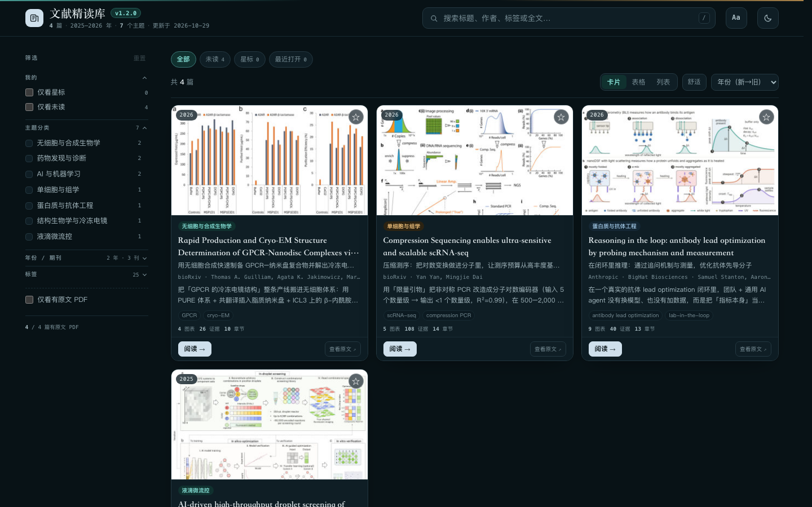

# Install and verify DSH-Paper-DeepRead

## 1. Install from the release tarball

Download `dsh-paper-deepread-1.7.0.tgz` (or use the copy from `dist/`) and install it into
the Web profile:

```bash
dsh plugin --profile web add ./dsh-paper-deepread-1.7.0.tgz
```

`dsh plugin` forwards to pnpm inside the profile directory. The package declares
`dsh.bundle.patch`, so the plugin manager adds `dsh-paper-deepread` to
`dsh.profile.bundles` and applies `cordis.patch.yml`.

If your shell cannot find `pnpm`, run the same command through the pnpm binary that
installed dsh, for example:

```bash
PATH="$HOME/Library/pnpm/bin:$PATH" dsh plugin --profile web add ./dsh-paper-deepread-1.7.0.tgz
```

## 2. Restart and open the UI

```bash
dsh web
```

Click the **Paper Deepread** icon in the left sidebar. The panel shows only the bundled
library page as a full-height iframe — the plugin has no tab row or toolbar of its own.
The library header's **上传** and **管理** entries open the management console (upload,
report management, 手机访问) in a new browser tab. The same pages are available directly:



```text
http://127.0.0.1:3080/paper-deepread/index.html    # library
http://127.0.0.1:3080/paper-deepread/manage.html   # management console
```

## 3. Verify the installation

Configuration row (composed profile tree):

```bash
dsh --profile web --dump-config | grep -A2 paper-deepread
```

Direct HTTP check:

```bash
curl -s -o /dev/null -w '%{http_code} %{content_type}\n' \
  http://127.0.0.1:3080/paper-deepread/index.html
# 200 text/html; charset=utf-8

curl -s http://127.0.0.1:3080/paper-deepread/api/state | head -c 400
# {"ok":true,...,"version":"1.7.0","skillVersion":"1.5.1","installedSkillVersion":"1.5.1",...}
```

Mobile access runtime (v1.6.0; its UI is a management-page tab since v1.7.0):

```bash
curl -s http://127.0.0.1:3080/paper-deepread/api/access | head -c 600
# {"ok":true,"version":"1.7.0","target":{"kind":"site","base":"http://127.0.0.1:8080/",
#  "label":"文献站点"},"local":{"url":"http://127.0.0.1:8080/",...},"lan":[...],
#  "tunnel":{"available":true,"status":"off","url":null,...},"hints":[...]}
```

Expected fields: `ok` (`true`), `version` (`1.7.0`), `target.kind` (`site` when `siteUrl` is
configured, otherwise `library` for the plugin's read-only LAN fallback server, otherwise
`web`), `target.base`, `local.url`, `lan[]` (each with `address`, `iface`, `label`, `url`,
`note`, `reachable`, `qrSvg`), `tunnel` (`available`, `status`, `url`, `upstream`, `error`,
`label`, `qrSvg`, `binary`) and `hints[]`. Every URL is absolute `http(s)` and each non-null
`qrSvg` starts with `<svg`. Without `siteUrl` the first request also starts the LAN fallback
server, so `target.kind` is `library` and `local.url` is its loopback address.

A report and a PDF inside a paper directory (URL-encoded path):

```bash
curl -s -o /dev/null -w '%{http_code}\n' \
  "http://127.0.0.1:3080/paper-deepread/2026-bioRxiv-Compression%20Sequencing%20enables%20ultra-sensitive%20and%20scalable%20scRNA-seq/2026-bioRxiv-Compression%20Sequencing%20enables%20ultra-sensitive%20and%20scalable%20scRNA-seq.html"
```

Model tool: ask the agent in any session to call `paper_deepread` (no arguments to list,
`query` to search, `id` to fetch one paper).

Skill: the first activation copies the bundled skill when
`~/.dsh/skills/paper-deepread-html` is missing. From v1.2.0 the plugin also keeps it in
sync (see §7). Check the installed version:

```bash
sed -n '1,5p' ~/.dsh/skills/paper-deepread-html/SKILL.md   # version: 1.5.1
cat ~/.dsh/paper-deepread/skill-state.json                 # installedVersion + contentHash
```

## 4. Uninstall

```bash
dsh plugin --profile web remove dsh-paper-deepread
```

Restart `dsh web`. The copied skill directory is not removed automatically; neither is the
managed data directory (including `skill-state.json`) nor the `.backup/` copies created by
the skill version sync.

## 5. Build from source

```bash
npm run check   # node --check on every shipped JavaScript file
npm test        # node:test suites (units, API, skill sync, site proxy, mobile access)
npm run pack    # -> dist/dsh-paper-deepread-1.7.0.tgz + dist/SHA256SUMS
```

Test against a throwaway profile instead of your live one:

```bash
dsh --profile pdr-test --from-default-profile web --dump-config >/dev/null
PATH="$HOME/Library/pnpm/bin:$PATH" dsh plugin --profile pdr-test add "$PWD/dist/dsh-paper-deepread-1.7.0.tgz"
dsh --profile pdr-test --dump-config | grep -A2 paper-deepread
dsh --profile pdr-test --port 3099 --no-open   # then curl 127.0.0.1:3099/paper-deepread/index.html
```

## 6. Upload and report management

Upload and report management happen in the **management console** (`library/manage.html`),
served both by the plugin and by the standalone site:

1. Open the **Paper Deepread** panel, then click **管理** in the library header (or **上传**
   to land on the console's upload tab). The console opens in a new browser tab; through
   the plugin it is `/paper-deepread/manage.html` and it talks to the plugin API.
2. Drag PDFs onto the drop zone (or click to pick). Uploads are capped at 80 MB and
   validated by their `%PDF-` signature; each file shows progress and joins the queue.
   Through the plugin the files land in the managed inbox the agent tools read.
3. Copy the prefilled instruction with **复制指令** and paste it into a chat (or just ask).
   The plugin does not call a model: an agent calls `paper_deepread_uploads` (`ingest`) and
   `paper_deepread_reports` (`build`) to run the bundled skill.
4. The first ingest/build prepares a PyMuPDF interpreter through the bundled skill's
   `setup_env.sh` (cached under `~/.cache/paper-deepread`; first run may download once).
   Preparation can also be triggered in chat with
   `paper_deepread_uploads` `{action: "env"}`.
5. In the console's **报告管理** tab, open a report or its RAW PDF, hide/show it, delete one
   report directory, or click **重建索引** (deterministic, no model needed).

The console also has the third **手机访问** tab — see §9. On the standalone site the same
page is `/manage.html` and uploads go to the site worker instead (see §8).

Managed data (defaults to `$DSH_HOME/paper-deepread`):

```text
~/.dsh/paper-deepread/
├── library/          seeded once from the packaged 文献精读库; user-owned afterwards
├── uploads/          uploaded PDFs
├── work/<id>/        ingest output + report sources (content.html, meta.json, figures.json)
├── state.json        upload inbox/status
├── skill-state.json  installed skill version + content hash (v1.2.0)
├── lan-server.json   手机访问 LAN fallback port (v1.6.0, disposable)
├── tunnel.json       手机访问 tunnel state snapshot (v1.6.0, disposable)
└── .seed.json        seed marker
```

Optional row config:

```yaml
- insert:
    - id: paper-deepread
      name: dsh-paper-deepread
      config:
        dataDir: /absolute/path/to/managed-data   # default $DSH_HOME/paper-deepread
        libraryDir: /path/to/existing/paper-read  # external library root, skips seeding
        maxUploadBytes: 52428800                  # 50 MB
        skillSync: update                         # update | keep
        siteUrl: http://127.0.0.1:8080            # optional standalone site (phone target)
        cloudflaredPath: /opt/homebrew/bin/cloudflared  # optional quick-tunnel binary
        cloudflaredProxy: "socks5://127.0.0.1:7890"     # optional proxy for cloudflared
        lanPort: 0                                # optional 手机访问 LAN fallback port
```

Reset: stop dsh, delete the data directory, restart. The packaged library is seeded
again on the next activation; uploaded PDFs, work directories, and `state.json` are lost.

Security notes: uploads need `content-type: application/pdf` and a `%PDF-` header;
report delete/visibility accept only a direct child directory name of the managed root
(absolute paths, `..`, and separator-containing names are rejected with `400`).

## 7. Skill version sync (v1.2.0)

The bundled skill declares `version:` in its SKILL.md frontmatter (`1.5.1`). On every
activation the plugin compares it with the installed copy and records the installed tree's
content hash in `<dataDir>/skill-state.json`:

| Installed copy | Behaviour |
| --- | --- |
| missing | install the bundled skill, record version + hash |
| `skillSync: "keep"` | never update an existing copy (log only) |
| version equal | skip |
| version newer | skip (never downgrade) |
| older, tree identical to recorded hash | back up to `~/.dsh/skills/.backup/paper-deepread-html-<old>-<UTC>/`, copy the bundle, refresh the hash |
| older but modified / untracked | keep the user's copy and warn |

Verify by editing a file under `~/.dsh/skills/paper-deepread-html` and restarting dsh: the
plugin logs a warning and leaves the edit in place. To hand the copy back to the plugin,
delete the installed directory once and restart.

## 8. Standalone site integration (v1.2.0)

When a standalone Paper Deepread site is running (default `http://127.0.0.1:8080`), add
its base URL to the plugin config:

```yaml
config:
  siteUrl: http://127.0.0.1:8080
```

`siteUrl` makes the site the preferred 手机访问 target and enables two same-origin proxy
routes (unchanged since v1.2.0):

1. `GET /paper-deepread/api/site/health` proxies `<siteUrl>/api/health` (5 s timeout, 5 s
   cache) and returns `{"configured":false}` when `siteUrl` is unset.
2. `POST /paper-deepread/api/site/upload` forwards a raw PDF body with `X-Filename`,
   `Content-Type`, and the optional `X-KB-Upload-Token` header to `<siteUrl>/api/upload`
   (120 s timeout) and returns the site JSON verbatim.

Since v1.7.0 the plugin panel renders no site status/upload card of its own: to hand a PDF
to the site's worker, open the site's own management console at `<siteUrl>/manage.html` and
use its 上传 tab.

Verify the proxy from the command line (with the site running):

```bash
curl -s http://127.0.0.1:3080/paper-deepread/api/site/health | head -c 300
# {"configured":true,"url":"http://127.0.0.1:8080","ok":true,...,"worker":{"online":true,...}}
```

With no `siteUrl` the routes return the unconfigured payload and the local inbox workflow is
unchanged.

## 9. 手机访问 — mobile access

The mobile-access UI is a tab in the management console: open the library page, click
**管理** in its header (the console opens in a new browser tab), then select the
**手机访问** tab. Through the plugin the console is `/paper-deepread/manage.html`, so the
tab's `api/access` calls reach the plugin host. Opened directly on the standalone site
(`:8080/manage.html`) the tab instead shows a note that 手机访问 requires the DSH panel.
Nothing is probed or bound on page load.

1. **Two blocks** — the tab shows 外网（临时） (Cloudflare quick tunnel, started
   automatically when the tab opens) and 局域网 · `<IP>` (the first non-loopback IPv4
   address; exactly one LAN address, no loopback or Bonjour entry). Each block carries a
   status chip: `连接中…` / `已开启` / `连接失败` / `未开启` for the tunnel, `可用` /
   `待确认` for the LAN address.
2. **QR and copy** — every block renders a scannable QR code from the URL the browser
   received in the host payload; 复制链接 copies the URL as text. 连不上？刷新链接 re-probes
   the LAN address (and, while the tunnel is running or failed, rebuilds it).
3. **Check it from a phone** — scan the LAN QR on a phone connected to the same Wi-Fi
   network. With `siteUrl` configured the phone opens the standalone site; otherwise it
   opens the plugin's read-only LAN fallback server.
4. **Tunnel** — the external block starts automatically; stop it with 关闭外网访问 when
   finished. The tunnel is not retried automatically after the first attempt on a page
   load — reload the management page to start it again. The plugin spawns `cloudflared`
   and shows the `https://<words>.trycloudflare.com` URL (usually within 5–20 s) once
   cloudflared prints its `quick Tunnel has been created` banner; the address changes
   whenever the tunnel or `dsh web` restarts. Check that `cloudflared` is installed
   (`command -v cloudflared`); without it the block reports
   `未找到 cloudflared，无法开启外网访问。` and the LAN block still works. If quick-tunnel
   creation fails the block shows `连接失败` with cloudflared's trimmed message (no QR
   code) — **连不上？刷新链接** posts `refresh` and retries.

Command-line checks:

```bash
# The payload the 手机访问 tab renders (expected fields are listed in §3).
curl -s http://127.0.0.1:3080/paper-deepread/api/access | head -c 400

# Tunnel actions: stop is safe even when the tunnel never started.
curl -s -X POST -H 'content-type: application/json' \
  -d '{"action":"stop"}' \
  http://127.0.0.1:3080/paper-deepread/api/access/tunnel | head -c 300
# {"ok":true,...,"tunnel":{"status":"off",...}}

# Without cloudflared a start returns 503 TUNNEL_UNAVAILABLE.
curl -s -o /dev/null -w '%{http_code}\n' -X POST -H 'content-type: application/json' \
  -d '{"action":"start"}' \
  http://127.0.0.1:3080/paper-deepread/api/access/tunnel
```

Optional configuration for the feature:

```yaml
config:
  siteUrl: http://127.0.0.1:8080                   # preferred phone target (standalone site)
  cloudflaredPath: /opt/homebrew/bin/cloudflared   # explicit tunnel binary
  cloudflaredProxy: "socks5://127.0.0.1:7890"      # proxy for the tunnel (macOS proxy hosts)
  lanPort: 8787                                    # pin the LAN fallback port
```

`cloudflared` is found from `cloudflaredPath`, the `CLOUDFLARED_BIN` environment variable,
`/opt/homebrew/bin/cloudflared`, `/usr/local/bin/cloudflared`, or `PATH`, in that order.

Tunnel troubleshooting: on macOS, cloudflared is a Go program and ignores the system proxy,
so behind a proxy such as ClashX the automatic tunnel start can end in `连接失败` with
`failed to request quick Tunnel ... context deadline exceeded` / `connection reset`. Set
`cloudflaredProxy` to the proxy your system uses — `socks5://127.0.0.1:7890` works on this
machine, while routing the quick-tunnel API through a plain HTTP proxy is flakier — and the
plugin passes it to the child as `HTTPS_PROXY`/`HTTP_PROXY`. The tunnel URL is only accepted
after the creation banner (multi-word `*.trycloudflare.com` hostnames), so an API endpoint
from an error message never appears as the tunnel address. **连不上？刷新链接** retries with
a fresh tunnel.

State written under the managed data directory: `lan-server.json` (remembered LAN fallback
port) and `tunnel.json` (last tunnel snapshot). Both are disposable and recreated on demand.

Security: the tunnel publishes the library to the internet without authentication — anyone
with the URL can read every report and PDF; enable it only when needed and close it
afterwards. The LAN fallback server is read-only (GET/HEAD static files only, no API or
uploads) but is reachable by any device on the same network while `dsh web` runs. `dsh web`
itself stays loopback-only and is never the phone target.
