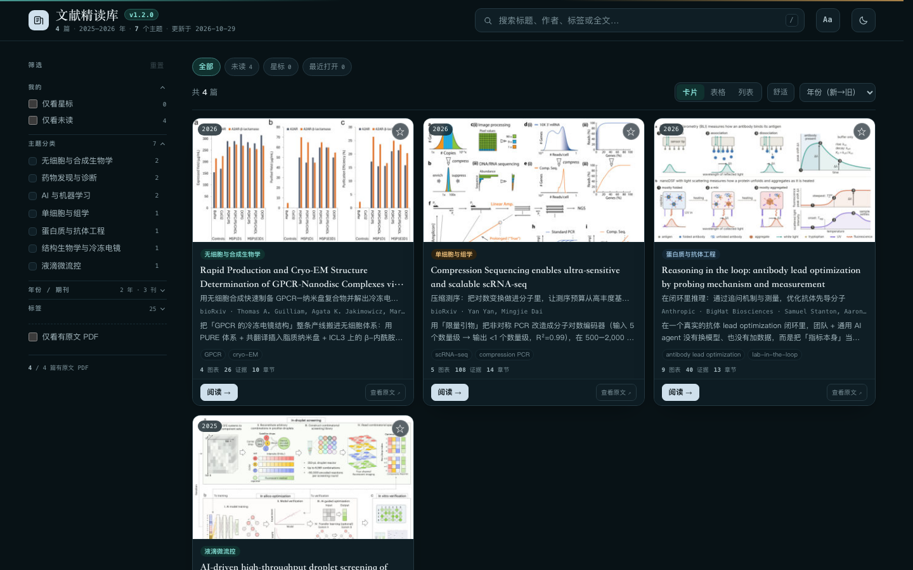

# Install and verify DSH-Paper-DeepRead

## 1. Install from the release tarball

Download `dsh-paper-deepread-1.3.0.tgz` (or use the copy from `dist/`) and install it into
the Web profile:

```bash
dsh plugin --profile web add ./dsh-paper-deepread-1.3.0.tgz
```

`dsh plugin` forwards to pnpm inside the profile directory. The package declares
`dsh.bundle.patch`, so the plugin manager adds `dsh-paper-deepread` to
`dsh.profile.bundles` and applies `cordis.patch.yml`.

If your shell cannot find `pnpm`, run the same command through the pnpm binary that
installed dsh, for example:

```bash
PATH="$HOME/Library/pnpm/bin:$PATH" dsh plugin --profile web add ./dsh-paper-deepread-1.3.0.tgz
```

## 2. Restart and open the UI

```bash
dsh web
```

Click the **Paper Deepread** icon in the left sidebar. The page renders inside the main
panel; the toolbar has *在新标签页打开* and *刷新*. The same page is available directly:



```text
http://127.0.0.1:3080/paper-deepread/index.html
```

## 3. Verify the installation

Configuration row (composed profile tree):

```bash
dsh --profile web --dump-config | grep -A2 paper-deepread
```

Direct HTTP check:

```bash
curl -s -o /dev/null -w '%{http_code} %{content_type}\n' \
  http://127.0.0.1:3080/paper-deepread/index.html
# 200 text/html; charset=utf-8

curl -s http://127.0.0.1:3080/paper-deepread/api/state | head -c 400
# {"ok":true,...,"skillVersion":"1.1.5","installedSkillVersion":"1.1.5",...}
```

A report and a PDF inside a paper directory (URL-encoded path):

```bash
curl -s -o /dev/null -w '%{http_code}\n' \
  "http://127.0.0.1:3080/paper-deepread/2026-bioRxiv-Compression%20Sequencing%20enables%20ultra-sensitive%20and%20scalable%20scRNA-seq/2026-bioRxiv-Compression%20Sequencing%20enables%20ultra-sensitive%20and%20scalable%20scRNA-seq.html"
```

Model tool: ask the agent in any session to call `paper_deepread` (no arguments to list,
`query` to search, `id` to fetch one paper).

Skill: the first activation copies the bundled skill when
`~/.dsh/skills/paper-deepread-html` is missing. From v1.2.0 the plugin also keeps it in
sync (see §7). Check the installed version:

```bash
sed -n '1,5p' ~/.dsh/skills/paper-deepread-html/SKILL.md   # version: 1.1.5
cat ~/.dsh/paper-deepread/skill-state.json                 # installedVersion + contentHash
```

## 4. Uninstall

```bash
dsh plugin --profile web remove dsh-paper-deepread
```

Restart `dsh web`. The copied skill directory is not removed automatically; neither is the
managed data directory (including `skill-state.json`) nor the `.backup/` copies created by
the skill version sync.

## 5. Build from source

```bash
npm run check   # node --check on every shipped JavaScript file
npm test        # node:test suites (units, API, skill sync, site proxy)
npm run pack    # -> dist/dsh-paper-deepread-1.3.0.tgz + dist/SHA256SUMS
```

Test against a throwaway profile instead of your live one:

```bash
dsh --profile pdr-test --from-default-profile web --dump-config >/dev/null
PATH="$HOME/Library/pnpm/bin:$PATH" dsh plugin --profile pdr-test add "$PWD/dist/dsh-paper-deepread-1.3.0.tgz"
dsh --profile pdr-test --dump-config | grep -A2 paper-deepread
dsh --profile pdr-test --port 3099 --no-open   # then curl 127.0.0.1:3099/paper-deepread/index.html
```

## 6. Upload and report management (v1.1.0)

1. Open the **Paper Deepread** panel and switch to **上传**.
2. Drag PDFs onto the drop zone (or click to pick). Uploads are capped at 80 MB and
   validated by their `%PDF-` signature; each file shows progress and joins the queue.
3. Copy the prefilled instruction with **复制指令** and paste it into a chat. The plugin
   does not call a model: an agent calls `paper_deepread_uploads` (`ingest`) and
   `paper_deepread_reports` (`build`) to run the bundled skill.
4. The first ingest/build prepares a PyMuPDF interpreter through the bundled skill's
   `setup_env.sh` (cached under `~/.cache/paper-deepread`; first run may download once).
   Preparation can also be triggered in chat with
   `paper_deepread_uploads` `{action: "env"}`.
5. Switch to **报告管理** to open a report or its RAW PDF, hide/show it, delete one
   report directory, or click **重建索引** (deterministic, no model needed).

Managed data (defaults to `$DSH_HOME/paper-deepread`):

```text
~/.dsh/paper-deepread/
├── library/          seeded once from the packaged 文献精读库; user-owned afterwards
├── uploads/          uploaded PDFs
├── work/<id>/        ingest output + report sources (content.html, meta.json, figures.json)
├── state.json        upload inbox/status
├── skill-state.json  installed skill version + content hash (v1.2.0)
└── .seed.json        seed marker
```

Optional row config:

```yaml
- insert:
    - id: paper-deepread
      name: dsh-paper-deepread
      config:
        dataDir: /absolute/path/to/managed-data   # default $DSH_HOME/paper-deepread
        libraryDir: /path/to/existing/paper-read  # external library root, skips seeding
        maxUploadBytes: 52428800                  # 50 MB
        skillSync: update                         # update | keep
        siteUrl: http://127.0.0.1:8080            # optional auto deep-read site
```

Reset: stop dsh, delete the data directory, restart. The packaged library is seeded
again on the next activation; uploaded PDFs, work directories, and `state.json` are lost.

Security notes: uploads need `content-type: application/pdf` and a `%PDF-` header;
report delete/visibility accept only a direct child directory name of the managed root
(absolute paths, `..`, and separator-containing names are rejected with `400`).

## 7. Skill version sync (v1.2.0)

The bundled skill declares `version:` in its SKILL.md frontmatter (`1.1.5`). On every
activation the plugin compares it with the installed copy and records the installed tree's
content hash in `<dataDir>/skill-state.json`:

| Installed copy | Behaviour |
| --- | --- |
| missing | install the bundled skill, record version + hash |
| `skillSync: "keep"` | never update an existing copy (log only) |
| version equal | skip |
| version newer | skip (never downgrade) |
| older, tree identical to recorded hash | back up to `~/.dsh/skills/.backup/paper-deepread-html-<old>-<UTC>/`, copy the bundle, refresh the hash |
| older but modified / untracked | keep the user's copy and warn |

Verify by editing a file under `~/.dsh/skills/paper-deepread-html` and restarting dsh: the
plugin logs a warning and leaves the edit in place. To hand the copy back to the plugin,
delete the installed directory once and restart.

## 8. Automatic deep-read site integration (v1.2.0)

When a standalone Paper Deepread site is running (default `http://127.0.0.1:8080`), add
its base URL to the plugin config:

```yaml
config:
  siteUrl: http://127.0.0.1:8080
```

The 上传 tab then shows an **自动精读** card:

1. **Status** — worker online dot, queue `uploaded`/`processing`, library count, and site
   version, refreshed every 8 s via `GET /paper-deepread/api/site/health` (the host
   proxies `<siteUrl>/api/health` with a 5 s timeout and a 5 s cache).
2. **Upload** — drag & drop or pick PDFs. Each file posts to
   `POST /paper-deepread/api/site/upload`; the host forwards the raw body with
   `X-Filename`, `Content-Type`, and the optional `X-KB-Upload-Token` header to
   `<siteUrl>/api/upload` (120 s timeout) and returns the site JSON verbatim.
3. **Feedback** — duplicates show the site message, possible duplicates show the matched
   title, `401 UPLOAD_TOKEN_REQUIRED` opens the token field (sessionStorage only; the
   plugin config never stores it), and `429 RATE_LIMITED` / queue-full are shown as
   returned.
4. **Links** — 打开站点管理台 → `<siteUrl>/manage.html`; 打开站点书库 → `<siteUrl>/`.

Verify the proxy from the command line (with the site running):

```bash
curl -s http://127.0.0.1:3080/paper-deepread/api/site/health | head -c 300
# {"configured":true,"url":"http://127.0.0.1:8080","ok":true,...,"worker":{"online":true,...}}
```

With no `siteUrl` the card is hidden and `/api/site/health` returns `{"configured":false}`;
the local inbox workflow is unchanged.
